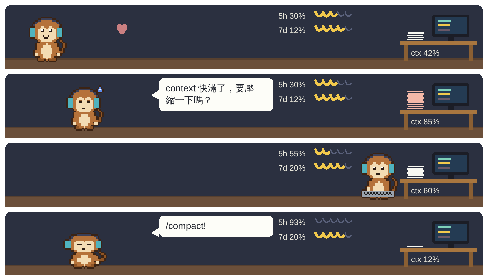

# Code Critter

A pixel-art desk pet for Claude Code. It lives in a short strip above the prompt box, mimics what Claude is doing, shows your usage as part of its room, and keeps your most-used slash commands one press away.

[繁體中文說明](README.zh-TW.md)



> An unofficial community project. Not affiliated with or endorsed by Anthropic.
> It is built on Claude Code's mod API, which is in early access and can change between releases.

## What it does

- **Mimics Claude.** The monkey picks up a magnifier when Claude reads files, a pencil for edits, a keyboard for shell commands and a spyglass for web searches, and splits in two when a subagent starts. It cheers when a turn ends and dozes off after ten idle minutes.
- **Mimics you.** Type a slash command and it repeats it in a speech bubble: it squashes itself flat for `/compact`, wipes the screen for `/clear` and tries on a hat for `/model`.
- **Shows usage in the room.** The paper stack on the desk is the context window. The two banana bunches are what is left of your 5-hour and 7-day limits. The row under the picture has the model, the time until each limit resets, and the session cost where there is one.
- **Nudges, once.** At 80% context the pet looks worn out and offers a **Run /compact** button. At 90% of a rate limit it tells you. Each can be closed and stays closed until the figure drops and climbs again. `/pet mute` turns bubbles off.
- **Recommends your commands.** Six buttons hold the slash commands you use most, recent use counting more (a count halves every 30 days). Pressing one runs it. `/clear` asks for a second press.
- **Has a mood.** Working together lifts it; hours of neglect lower it. The worst that happens is a bored monkey.
- **Takes new characters.** One folder and one JSON file per character. Only an idle animation is required.

## Install

At the prompt of a terminal session:

```
/plugin install code-critter --marketplace SeanSuS/code-critter
```

From a shell:

```
claude plugin install code-critter --marketplace SeanSuS/code-critter
```

In the desktop app, where `/plugin` does not run: click **+** next to the prompt box, then **Plugins**, **Add marketplace** with `SeanSuS/code-critter`, then **Add plugin**.

The animated scene is drawn in the desktop app's Code tab. A terminal shows the buttons and figures without the picture.

## Commands

| Command | What it does |
| --- | --- |
| `/pet` | Show or hide the pet |
| `/pet char <name>` | Switch character (also a picker in the row of buttons) |
| `/pet reload` | Re-read the character folders and report any errors |
| `/pet create <description>` | Ask Claude to draw a character and load it |
| `/pet lang en\|zh-TW\|auto` | Interface language |
| `/pet mute` | Turn speech bubbles off or back on |
| `/pet reset` | Clear the command history and reset the mood |
| `/explain` | Ask Claude to explain the code being worked on |
| `/commit-msg` | Ask Claude to draft a commit message |

## Add your own character

Characters live in `~/.claude/code-critter/characters/<name>/character.json` (Windows: `%USERPROFILE%\.claude\code-critter\characters\<name>\character.json`). Run `/pet reload` after adding one; nothing needs reinstalling.

**With AI.** Either run `/pet create a sleepy blue owl` inside Claude Code, or paste [CHARACTER_PROMPT.md](CHARACTER_PROMPT.md) into any AI with your description, save its answer to the path above and run `/pet reload`. If a row is the wrong length the pet says which state, frame and row; paste that back to the AI.

**By hand.** A character is a palette and frames of text, one character per pixel, `.` for transparent:

```json
{
  "schemaVersion": 1,
  "name": "blob",
  "author": "you",
  "license": "CC0-1.0",
  "size": 16,
  "palette": { "o": "#3b2314", "g": "#7fd1b9" },
  "states": {
    "idle": { "fps": 2, "frames": [["16 strings of 16 characters"], ["..."]] },
    "sleep": { "fallbackTo": "idle" }
  }
}
```

`size` is 16, 24 or 32. A state has 1 to 8 frames. Only `idle` is required: [CHARACTER_PROMPT.md](CHARACTER_PROMPT.md) lists every state and what a missing one falls back to. [characters/monkey/character.json](characters/monkey/character.json) is a complete example, generated by `tools/build-monkey.mjs`.

Only add characters you have the right to use. Please do not submit copyrighted characters to this repository.

## Privacy

The interface is in Traditional Chinese where the system reports no language; `/pet lang en` switches it.

The pet stores its mood, your settings and a count per slash-command name in the mod's own store on your computer. It never reads your messages, and sends nothing anywhere. `/pet create` sends one prompt to Claude in your session, which uses your tokens like any other prompt.

## Development

```
claude plugin validate .
claude plugin test .
claude --plugin-dir .
```

`tsc -p .` type-checks once Claude Code has loaded the mod from this folder and written `.claude-plugin/types/`.

## License

MIT. The monkey artwork is original to this project and under the same license.
