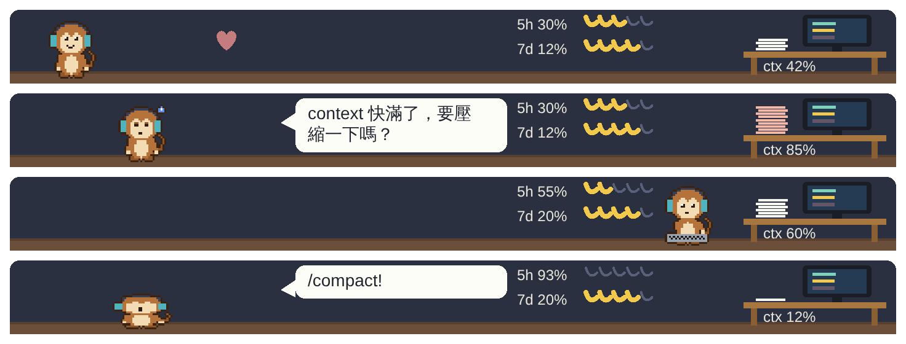

# Code Critter

Claude Code 的像素風桌面寵物。牠住在輸入框上方的一條橫幅裡，會模仿 Claude 正在做的事，把你的用量畫進牠的房間，並把你最常用的 slash 指令做成按鈕，按一下就執行。

[English](README.md)



> 這是非官方的社群專案，與 Anthropic 無關，也未經 Anthropic 背書。
> 本專案使用 Claude Code 的 Mod API，該 API 仍在 early access 階段，可能隨版本更新而改變。

## 功能

- **模仿 Claude。** Claude 讀檔時猴子拿放大鏡，改檔時拿筆，跑指令時敲鍵盤，上網搜尋時拿望遠鏡，啟動 subagent 時變出一隻分身。一輪工作結束牠會歡呼，閒置十分鐘就睡著。
- **模仿你。** 你輸入 slash 指令，牠會在對話泡泡裡跟著喊：`/compact` 時把自己壓扁，`/clear` 時拿抹布擦畫面，`/model` 時換一頂帽子。
- **把用量畫進房間。** 桌上的紙堆是 context 用量，牆上的兩串香蕉是 5 小時和 7 天額度的剩餘量。畫面下方那一列有目前模型、各額度的重置倒數，以及有資料時的費用。
- **只提醒一次。** context 到 80% 時猴子會變累，並給你一個「執行 /compact」按鈕；額度用到 90% 時牠會提醒你。提醒可以關掉，要等數字降下去又升回來才會再出現。`/pet mute` 可以關掉所有泡泡。
- **推薦你的常用指令。** 六個按鈕放你最常用的 slash 指令，近期使用的權重較高（每 30 天減半）。按下去直接執行，`/clear` 要再按一次確認。
- **有心情。** 一起完成工作會讓牠開心，好幾個小時不理牠會變無聊。最糟也只是一隻無聊的猴子，不會死。
- **可以加新角色。** 一隻角色一個資料夾、一個 JSON 檔，只有待機動畫是必填。

## 安裝

在終端機的 Claude Code 提示字元輸入：

```
/plugin install code-critter --marketplace SeanSuS/code-critter
```

或在 shell 執行：

```
claude plugin install code-critter --marketplace SeanSuS/code-critter
```

桌面版不能執行 `/plugin`：請按輸入框旁的 **+** → **Plugins** → **Add marketplace**，輸入 `SeanSuS/code-critter` → **Add plugin**。

動畫場景顯示在桌面版的 Code 分頁。終端機只會顯示按鈕和數字，沒有畫面。

## 指令

| 指令 | 作用 |
| --- | --- |
| `/pet` | 顯示或隱藏寵物（按「收合」按鈕則是縮成一行） |
| `/pet char <名字>` | 切換角色（按鈕列裡也有下拉選單） |
| `/pet reload` | 重新讀取角色資料夾，並回報錯誤 |
| `/pet create <描述>` | 請 Claude 畫一隻角色並載入 |
| `/pet lang en\|zh-TW\|auto` | 介面語言 |
| `/pet mute` | 關閉或重新開啟對話泡泡 |
| `/pet reset` | 清空指令使用紀錄並重設心情 |
| `/explain` | 請 Claude 解釋正在處理的程式碼 |
| `/commit-msg` | 請 Claude 草擬 commit 訊息 |

系統沒有回報語言時，介面預設是繁體中文；想用英文請輸入 `/pet lang en`。

## 加入自己的角色

角色放在 `~/.claude/code-critter/characters/<名字>/character.json`（Windows：`%USERPROFILE%\.claude\code-critter\characters\<名字>\character.json`）。加入後輸入 `/pet reload` 即可，不用重新安裝。

**用 AI 生成。** 在 Claude Code 裡輸入 `/pet create 一隻愛睡覺的藍色貓頭鷹`；或把 [CHARACTER_PROMPT.md](CHARACTER_PROMPT.md) 貼給任何 AI 並附上你的描述，把它的回答存到上面的路徑，再輸入 `/pet reload`。如果某一行長度不對，寵物會指出是哪個狀態、第幾格、第幾行，把那段訊息貼回給 AI 修正就好。

**手動製作。** 角色檔是一組調色盤加上用文字寫的畫格，一個字元代表一個像素，`.` 代表透明：

```json
{
  "schemaVersion": 1,
  "name": "blob",
  "author": "you",
  "license": "CC0-1.0",
  "size": 16,
  "palette": { "o": "#3b2314", "g": "#7fd1b9" },
  "states": {
    "idle": { "fps": 2, "frames": [["16 行、每行 16 個字元"], ["..."]] },
    "sleep": { "fallbackTo": "idle" }
  }
}
```

`size` 可以是 16、24 或 32，每個狀態 1 到 8 格。只有 `idle` 必填；[CHARACTER_PROMPT.md](CHARACTER_PROMPT.md) 列出所有狀態，以及沒做時會改用哪個狀態。[characters/monkey/character.json](characters/monkey/character.json) 是完整範例，由 `tools/build-monkey.mjs` 產生。

請只加入你有權使用的角色，也請不要把有版權的角色提交到這個 repo。

## 隱私

寵物只在你的電腦上儲存心情、設定，以及每個 slash 指令名稱的使用次數。牠不會讀你的訊息內容，也不會把任何資料傳出去。`/pet create` 會在你的 session 送一則 prompt 給 Claude，和一般 prompt 一樣會用到你的額度。

## 授權

MIT。猴子的美術是本專案的原創作品，採用相同授權。
